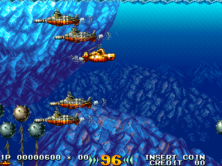
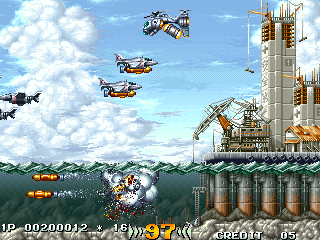
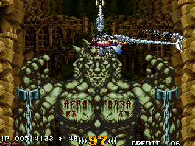
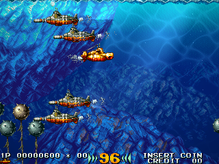
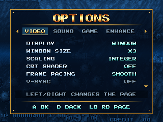

<h1 align="center">IN THE HUNT</h1>

<strong>The arcade submarine shooter. A native Windows port.</strong>

  <a href="https://github.com/meathax/inthehunt/releases">Releases</a> ·
  <a href="#install-and-play">Get started</a> ·
  <a href="docs/PLAYER-GUIDE.md">Player guide</a> ·
  <a href="https://github.com/meathax/inthehunt/issues">Report a problem</a>

  

Actual gameplay from the native port, with visual enhancements disabled.

An unofficial native Windows port of Irem's **In the Hunt** (1993). Take the submarine through six stages of underwater combat, battle enormous bosses, and play solo or with a friend in local two-player co-op.

The original V33 game program and V35 sound program have been translated into C and compiled for Windows. The arcade CPUs are not emulated; the port supplies native video, input and sound-chip models.

> **Bring your own game.** You need the World arcade ROM set, `inthunt`. Original ROM images and standalone game assets are not included. The Japanese and US sets are not supported.

## Features

- **The full arcade route:** all six stages, bosses, both endings, continues and local two-player play.
- **Native controls and menus:** keyboard or Xbox-style controllers, a title menu, pause menu and saved options.
- **Your choice of picture:** sharp integer scaling, fit-to-screen 4:3, fullscreen and twelve CRT shader presets.
- **Optional underwater effects:** caustics, light shafts, dynamic lighting, shadows, reflections, wakes, debris and surface splashes.
- **Flexible presentation:** display-synchronised frame pacing, optional smooth scrolling and motion interpolation on supported high-refresh displays.
- **Arcade slowdown or full speed:** retain the port's approximation of the original slowdown, or switch it off.

Visual enhancements are **off by default**. See the [player guide](docs/PLAYER-GUIDE.md) for individual effects, performance tradeoffs and combinations that cannot run together.

## Screenshots

<table>
  <tr>
    <td> Surface combat · enhancements off</td>
    <td> Submerged ruins · enhancements off</td>
  </tr>
  <tr>
    <td> Optional enhancements · same scene as the opening image</td>
    <td> Native options · video, sound, game and enhancements</td>
  </tr>
</table>

These are captures from the port's native renderer, not reference-emulator screenshots or mockups. [Capture provenance](docs/screenshots/README.md).

## What you need

| Requirement | Details |
|---|---|
| System | Windows 10 or 11, 64-bit |
| Launcher | PowerShell 5 or later; Windows `tar.exe` for ROM import |
| Game data | Your own World `inthunt.7z` archive; chip contents are SHA-1 checked |
| CRT shaders | A Direct3D 12-capable GPU |
| Input | Keyboard or Xbox-style controller; a second controller for player two |

The packaged Windows build needs **no Python, Visual Studio or compiler**. Source builds download the pinned Zig compiler on first use.

## Install and play

1. Open [Releases](https://github.com/meathax/inthehunt/releases) and select **`InTheHunt-Windows-x64.zip`**, when available. GitHub's automatic source-code ZIP is not the playable build.
2. Extract **everything** to a writable folder, such as `D:\Games\InTheHunt`.
3. Double-click **`play.cmd`**.
4. On first launch, choose your `inthunt.7z`. The launcher also checks Downloads and the folder beside `play.cmd`.
5. Choose **Start Game** on the title menu.

Imported data stays in `.local/world`; subsequent launches do not need the archive. Settings are stored in `.local/world/native-settings.ini`. The launcher may download optional border art; if the download fails, play continues with a black border.

**Building instead?** Follow the [source build instructions](docs/DEVELOPMENT.md). From a prepared source checkout, `.\play.ps1` imports the data and builds the executable when needed.

## Settings

Press **F1**, **Esc**, or **Start** on a controller to open the pause menu. Choose **Options**, then use Q/E or the shoulder buttons to change tabs.

| Tab | Options |
|---|---|
| Video | Window/fullscreen, scaling, CRT shaders, frame pacing, FPS display and border art |
| Sound | Master volume and separate FM/PCM levels |
| Game | Slowdown, difficulty, submarines, demo sound, autofire and auto-pause |
| Enhance | Optional lighting, water effects, smooth scrolling and other presentation effects |

Settings save when the menu closes. [Read the full player guide →](docs/PLAYER-GUIDE.md)

## Controls

| Action | Player 1 keyboard | Player 2 keyboard | Xbox-style controller |
|---|---|---|---|
| Move | Arrow keys | W A S D | D-pad or left stick |
| Torpedo / fire | Z | G | A |
| Secondary weapon | X | H | B |
| Insert coin | 5 | 6 | Back |
| Start / join / continue | 1 | 2 | A |
| **Pause menu** | **F1** or Esc | **F1** or Esc | **Start** (or L3 + R3) |

Each controller drives its own player. Key and button assignments are stored in `.local/world/native-settings.ini`.

## Status and known limitations

The native port has completed multi-loop headless playthroughs, two-player input tests, both ending-branch tests and a 156-run crash matrix. A freshly extracted Windows package has also passed import and replay checks. See the [verification record](docs/VERIFICATION.md) for the exact scope and remaining interactive checks.

- **Slowdown is approximate**, not cycle-exact arcade timing.
- Whole-game frame-by-frame equivalence and bit-identical audio have not been established.
- A few rare translated branches estimate leftover CPU register values.
- CRT shaders and some enhancements cannot be combined. Motion interpolation has display and scaling requirements.
- Monitor pacing, focus/fullscreen transitions, audible mixing, controller hot-plug and rumble still need interactive release qualification.

This is release preparation; a final release version has not been assigned. [Release checklist](docs/RELEASING.md).

## Updating

Back up `.local/world` first. Extract the new release into a new writable folder, copy your existing `.local/world` into it, then start the new `play.cmd`. Keep the previous installation until you have confirmed the update works. Do not overwrite an installation while the game is running.

## Reporting a problem

[Open an issue](https://github.com/meathax/inthehunt/issues) with what happened, the stage and steps to reproduce it. Include your build or commit, Windows version, GPU and controller, and whether CRT shaders or enhancements were enabled. A screenshot helps.

If the port stops at an untranslated routine, include the address from `.local/world/native-stops.tsv`. Do not upload ROM archives, imported game data or machine-state snapshots.

## Development

The game and Windows host live in `src/`; build, import and verification tools live in `tools/`. Generated files and imported data stay in ignored `.local/` and `build/` directories.

[Build instructions and source map](docs/DEVELOPMENT.md) · [Verification](docs/VERIFICATION.md) · [Release notes](RELEASE-NOTES.md) · [Release procedure](docs/RELEASING.md)

## Credits and licences

**In the Hunt © 1993 Irem.** This is an unofficial project, not affiliated with or endorsed by Irem. The translated game program is derived from the original game; you supply the original ROM data.

Thanks to the MAME contributors, Aaron Giles and the ymfm contributors, librashader, the Libretro shader authors, and the other projects listed in [CREDITS.md](CREDITS.md). Dependency terms are retained in [LICENSES/](LICENSES) and the shader bundle.

A top-level licence for project-authored code remains to be selected; dependency licences do not establish one for the whole repository.
