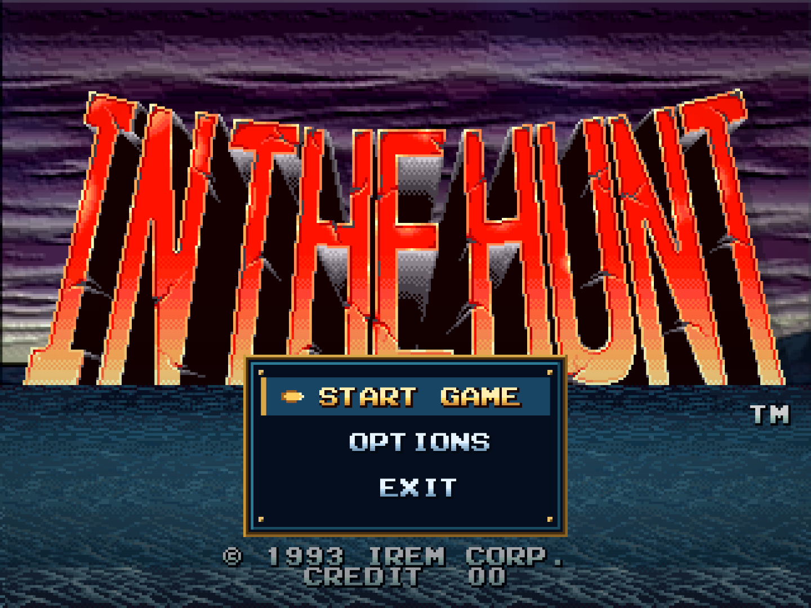
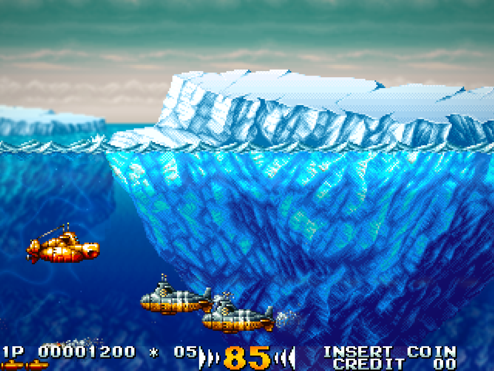
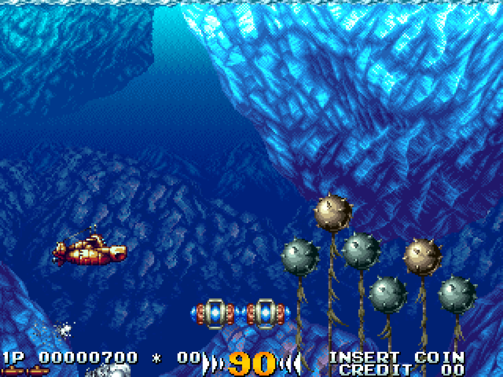

# IN THE HUNT

**0.9.2 Beta** · An unofficial native Windows port of Irem’s submarine shooter.

[**Download for Windows**](https://github.com/meathax/inthehunt/releases/download/v0.9.2/InTheHunt-Windows-x64.zip) · [Release notes](https://github.com/meathax/inthehunt/releases/tag/v0.9.2) · [Report a bug](https://github.com/meathax/inthehunt/issues)

- All six stages, both endings and local two-player co-op.
- Keyboard and Xbox-style controllers, saved settings and pause menus.
- Integer scaling, fullscreen, 12 CRT presets and optional underwater effects.
- Arcade-style slowdown or Remove Slowdown; RecompLauncher import and settings support.

<p align="center">
  
</p>
<p align="center">
  
  
</p>

## Play

**Requires Windows 10/11 x64 and your own World `inthunt.zip` or `inthunt.7z` ROM archive.** No game data is included; Japanese/US sets are unsupported.

1. Download **InTheHunt-Windows-x64.zip** and extract everything.
2. Open **InTheHunt.exe** and select your World ROM archive. The game imports it once, then starts automatically.

No Python or compiler needed. The built-in importer uses Windows PowerShell and `tar.exe`; CRT presets need Direct3D 12. After import, the original archive can be moved or removed.

## Controls

| Action | Player 1 | Player 2 | Xbox-style pad |
|---|---|---|---|
| Move | Arrows | W A S D | D-pad / left stick |
| Fire | Z / X | G / H | A / B |
| Coin | 5 | 6 | Back |
| Start / join | 1 | 2 | A |
| Options | F1 / Esc | F1 / Esc | Start |

## Make it yours

Open **Options** for video, sound, difficulty and enhancements. Effects are **off by default** to preserve the arcade picture. Enable lighting, reflections, particles and more under **Enhance**.

<details>
<summary>Every enhancement at a glance</summary>

| Option | Effect |
|---|---|
| **Enhancements** | Master switch; off keeps the arcade picture. |
| **Caustics** | Rippling underwater light. |
| **Light Shafts** | Sunbeams from the surface. |
| **Sun Shadows** | Scenery blocks sunlight. |
| **Path Tracing** | Coloured lighting, soft shadows and light bounces; no RTX card required. |
| **Water Glow** | Scattered light around explosions. |
| **Absorption** | Red light fades with depth. |
| **Marine Snow** | Drifting underwater particles. |
| **Vivid Color** | Stronger colour and contrast. |
| **Vignette** | Darker corners. |
| **Motion Trails** | Phosphor-style afterimages. |
| **Smooth Scroll** | Smoother camera movement between pixels. |
| **Motion X2** | Intermediate motion frames on supported 120 Hz+ displays. |
| **Drop Shadows** | Sprites cast shadows on scenery. |
| **Depth Haze** | Distant scenery fades toward blue. |
| **Depth of Field** | Softens the far background. |
| **Normal Maps** | Surface-relief lighting on rock and ice. |
| **Live Surface** | Waterline ripples and glints. |
| **Reflections** | Sky reflections on the water. |
| **Shockwaves** | Spreading distortion around blasts. |
| **Particles** | Explosion embers and bubbles. |
| **Shake + Rumble** | Screen shake and controller vibration. |
| **Wakes + Turbulence** | Curling submarine and torpedo trails. |
| **Destruction Debris** | Tumbling, settling wreckage. |
| **Impact Silt** | Sediment clouds near impacts. |
| **Surface Splashes** | Spray and ripples at waterline crossings. |
| **Underwater Sparks** | Brief hot flecks. |
| **Impact Particles** | Sinking debris and rising bubbles. |
| **Pressure Waves** | Background refraction and bubble rings. |
| **Lit Sediment** | Sediment catches explosion light. |
| **Volumetric Water** | Light beams within the water. |
| **Ocean Depth** | Distant scenery blends into the ocean. |
| **Battle Aftermath** | Lingering bubbles and cooling flecks. |
| **Sprite Materials** | Distinct lighting for paint, metal, rust and glass. |
| **Stereo 3D** | Red-cyan picture for anaglyph glasses. |

</details>

CRT presets are under **Video**. Smooth Scroll and Motion X2 cannot run with CRT; Motion X2 needs a supported 120 Hz+ display. Effects can reduce performance.

## Updates & beta status

To update, back up **`.local/world`**, extract the new version into a fresh folder and copy that directory across.

Nearly feature-complete. Arcade slowdown is approximate; live launcher, audio, GPU presentation and physical-controller testing remain incomplete. RecompLauncher catalogue listing is pending. Include your version, hardware, stage and enabled effects when reporting bugs; never upload ROMs.

## Build & credits

[Dependency licences](LICENSES)

<details>
<summary>Build from source</summary>

Requires Windows 10/11 x64, PowerShell 5+ and Windows `tar.exe`. The build downloads and verifies Zig 0.16.0; Visual Studio is not required.

```powershell
. .\tools\world_native.ps1
Build-WorldNative -Root (Get-Location).Path
```

The executable is written to `.local/native/InTheHunt.exe`. Open the executable to select and import your World ROM archive.

For optional CRT presets, place `librashader.dll` v0.12.0 and `dxcompiler.dll` v1.9.2609 in `third_party/librashader/` before building. The published Windows ZIP includes these runtimes. Generate the shader data with Python 3 from the pinned libretro checkout:

```powershell
python -I tools/make_shaders.py --slang C:/path/to/slang-shaders
```

Use slang-shaders revision `2345ee91602a7404d3a1a6a5df6108d7305fdad4`. The script copies preset dependencies and their licence notices to `.local/shaders`. The release uses unmodified librashader revision `87e8a97b50516d997defeaa168173dcd185d4022`, built with the Direct3D 12 runtime and static C runtime. Runtime SHA-256 values:

| Runtime | SHA-256 |
|---|---|
| librashader.dll | `8e5912fc7432ff39e935c61674823f37b96a824bb6c727f1319cc31fc561a74a` |
| dxcompiler.dll | `0689e2fee0a1c9df8662a59680469f24e2a3ad7ce6bbbcc9284f7a83172bfc59` |

Game and host source live in `src/`; `tools/` contains build, import and runtime support. The icon and ROM selector background are embedded build inputs. Generated files, imported ROMs and local settings are ignored. The importer scripts and ROM metadata are embedded into the executable; RecompLauncher uses its `--import-rom` command.

</details>

In the Hunt © 1993 Irem. Unofficial and unaffiliated; a top-level project licence is not yet settled. Thanks to MAME, ymfm, CPS-2 Recomp, FinalBurn Neo, the MiSTer Irem M92 project, librashader, Libretro shader authors, DirectX Shader Compiler and Blur Busters. Dependency notices remain with the source and packaged libraries.
