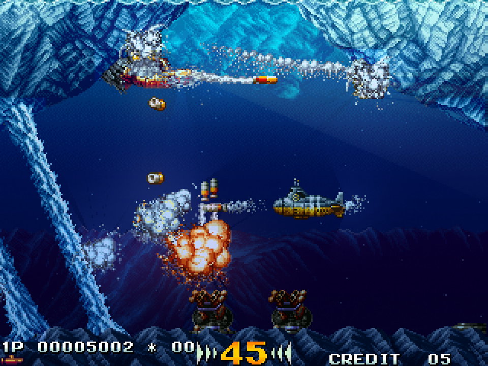
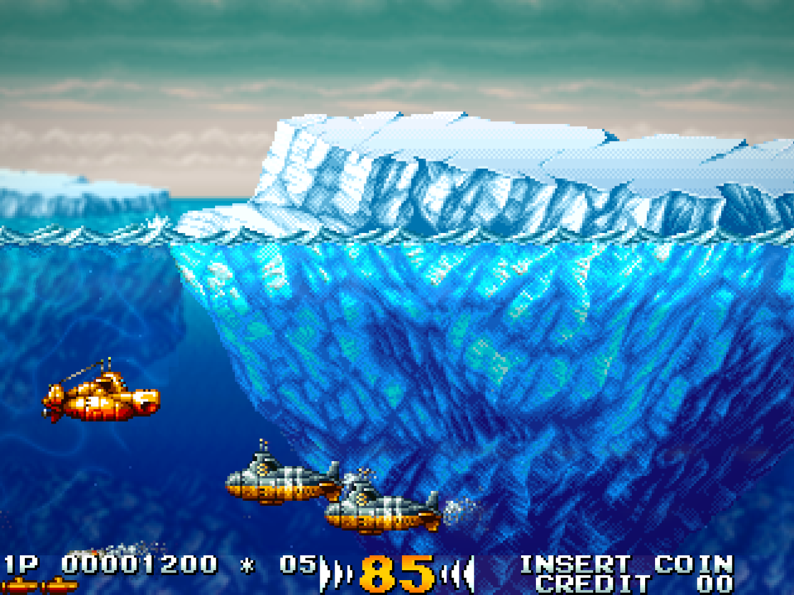
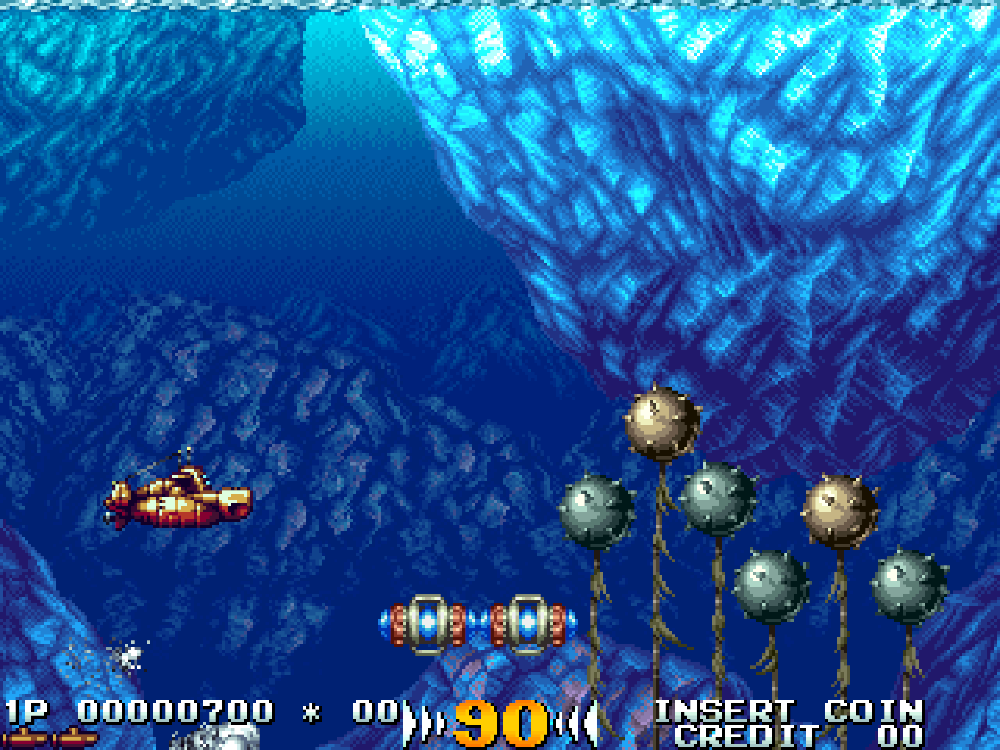
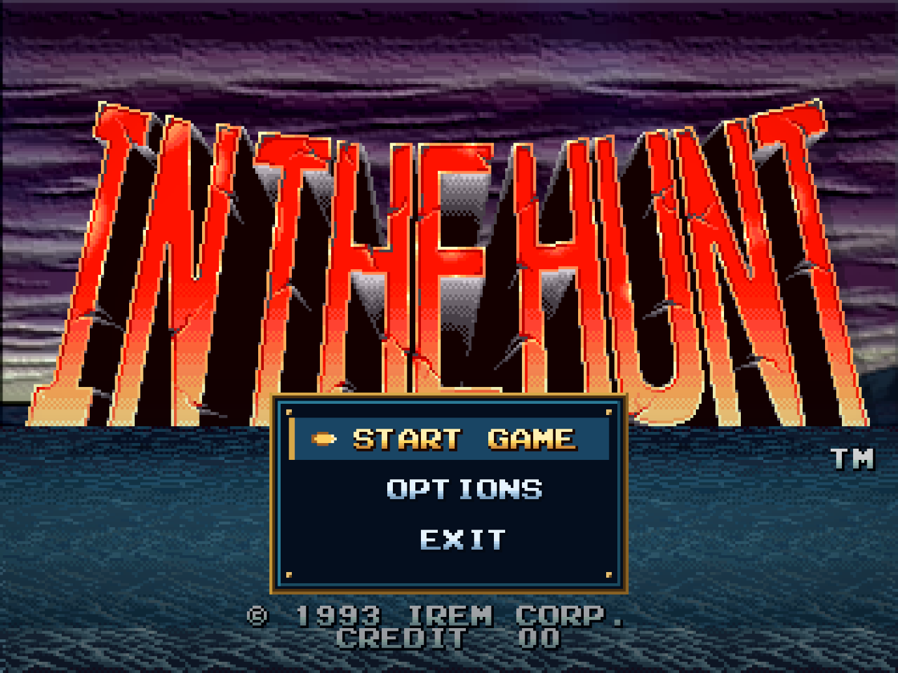
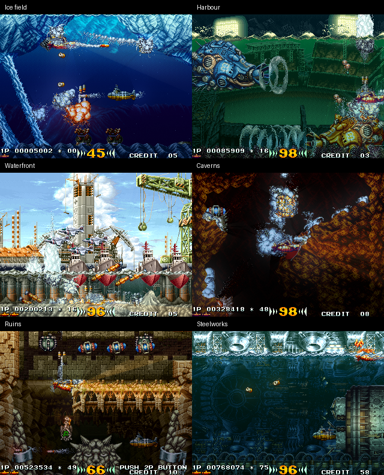
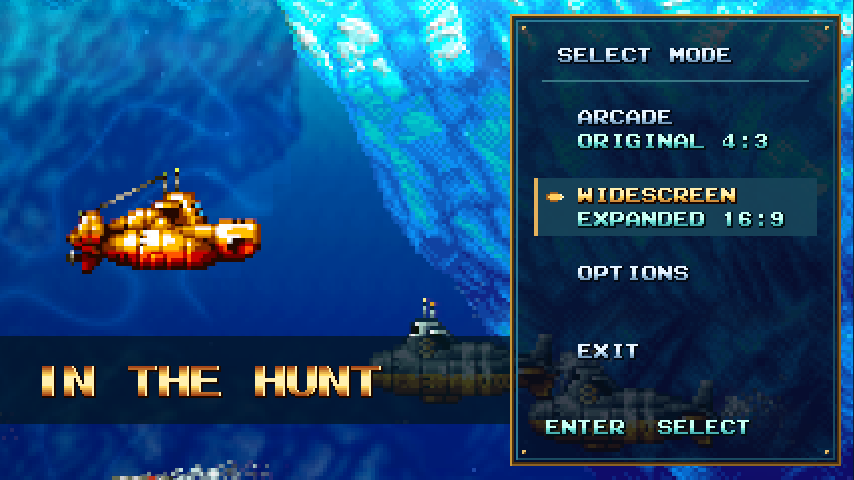
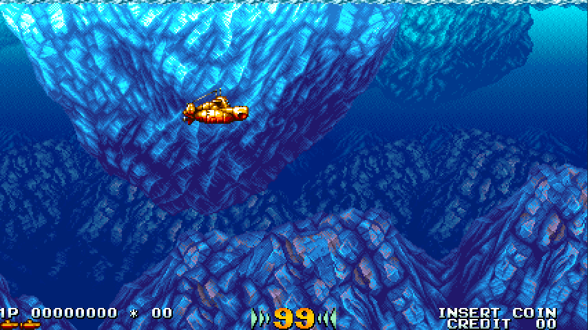

# In the Hunt for Windows

Irem’s 1993 submarine shooter runs natively on Windows using your own MAME ROM archive. Play all six stages and both endings solo or in local two-player co-op.

<p align="center"></p>

| Ice Cavern | Minefield | Submarine Headlights |
| --- | --- | --- |
|  |  |  |

| Title Screen | Lighting Across All Six Stages |
| --- | --- |
|  |  |

| Mode selection | Widescreen gameplay |
| --- | --- |
|  |  |

**Experimental 16:9 widescreen and 21:9 ultrawide**

## What the PC port adds

- **Arcade, Widescreen and Ultrawide.** Pick the original 4:3 game, expanded 16:9 gameplay or 64:27 ultrawide (21:9 monitors) under **Options → Video → Aspect**. Each mode keeps its own high scores. Choose Play to start, or leave the menu idle for five seconds to watch the attract sequence.
- **Optional enhanced effects.** Pick a lighting preset or tune effects individually, including bow lamps, dynamic shadows, light shafts, particles, water caustics and radiance-cascade bounce light.
- **Underwater stereo.** Hear positional weapons, submarine motors, machinery and stage ambience. Adjust music, effects and ambience levels or enable Reduced Bass.
- **PC display options.** Choose exact arcade frame timing or smooth camera scrolling, and select from optional Libretro CRT presets.
- **Wider boss arenas.** Bosses reach and shoot at subs hugging the far edges of the wider views, and every boss hand-off and stage transition works in all three modes.
- **Local two-player play.** Share a keyboard or use gamepads to play the full arcade campaign together.
- **Arcade slowdown.** Enable PCB-calibrated slowdown in **Options → Game**.

## Play

On Windows 10 or 11 x64, extract the [Windows release ZIP](https://github.com/meathax/inthehunt/releases/latest/download/InTheHunt-Windows-x64.zip), open `InTheHunt.exe` and select your own MAME ROM archive (ZIP or 7z). Setup imports it once and starts the game.

Use a merged archive, a complete non-merged set, or a split clone with its parent (`inthunt.zip` or `inthunt.7z`) in the same folder. World, US (`inthuntu`), Japan (`kaiteids`) and Korea (`inthuntk`) imports all run the World edition. See the [release notes](https://github.com/meathax/inthehunt/releases/latest) or [report a bug](https://github.com/meathax/inthehunt/issues).

## Build from source

Open PowerShell 5 or later in the repository on Windows x64 with Windows `tar.exe` available. The build downloads and verifies Zig 0.16.0.

```powershell
. .\tools\world_native.ps1
Build-WorldNative -Root (Get-Location).Path
```

Open `.local/native/InTheHunt.exe` to import your ROM archive. For CRT shader support, place `librashader.dll` v0.12.0 and `dxcompiler.dll` v1.9.2609 in `third_party/librashader/` before building.

In the Hunt © 1993 Irem. This is an unofficial, unaffiliated port. See the [dependency licences](LICENSES).
