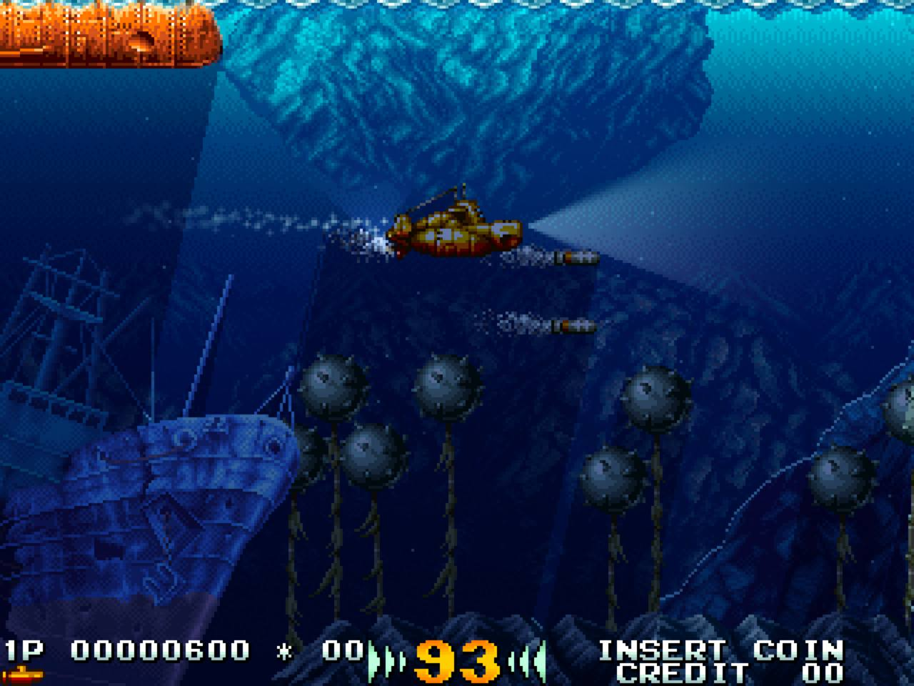
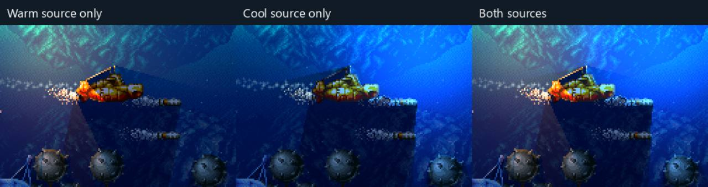

# In the Hunt

**0.9.6 Beta** · An unofficial native Windows port of Irem’s 1993 submarine shooter. Play all six stages and both endings solo or in local two-player co-op.

[Download for Windows x64](https://github.com/meathax/inthehunt/releases/latest/download/InTheHunt-Windows-x64.zip) · [Release notes](https://github.com/meathax/inthehunt/releases/latest) · [Report a bug](https://github.com/meathax/inthehunt/issues)



## New in 0.9.6

Each dynamic light casts its own pixel shadows. A hull blocking a warm weapon flash can still catch cool light from the opposite side. Light now escapes its emitting hull or tile, and explosion sprites let their own light reach nearby objects.



## Lighting and performance

- The D3D12 lighting engine casts sharp sun shadows to the edge of the screen. Gunfire and explosions light the facing edges of hulls and wreckage.
- Switch on **Sub Headlights** to project a beam from each player’s bow. Terrain and sprites cast shadows through the beam.
- Faster shadow-mask preparation and water shading reduced CPU rendering time in three boss fights with every enhancement enabled.

## Play

**Requires Windows 10/11 x64 and your own In the Hunt MAME ROM archive (ZIP or 7z).**

1. Download **InTheHunt-Windows-x64.zip** and extract everything.
2. Open **InTheHunt.exe** and select your ROM archive. The game imports it once, then starts automatically.

Select the merged archive, any complete non-merged set, or a split clone with its parent (`inthunt.zip` or `inthunt.7z`) in the same folder. World, US (`inthuntu`), Japan (`kaiteids`), and Korea (`inthuntk`) all run the World edition. The importer identifies chips by content, so older MAME filenames and nested folders work.

No Python or compiler needed. The built-in importer uses Windows PowerShell and `tar.exe`; CRT presets need Direct3D 12. After import, the original archive can be moved or removed.

## Controls

| Action | Player 1 | Player 2 | Xbox-style pad |
|---|---|---|---|
| Move | Arrows | W A S D | D-pad / left stick |
| Fire | Z / X | G / H | A / B |
| Coin | 5 | 6 | Back |
| Start / join | 1 | 2 | A |
| Options | F1 / Esc | F1 / Esc | Start |

## Graphics and frame pacing

Open **Options → Enhance** to choose a preset or toggle any effect. All three presets include point lights, rim lighting, sun shadows and submarine headlights. **Low** keeps the core lighting and depth grade. **Medium** adds shafts, scattering, wakes and particles. **High**, the default, enables every effect. The master switch remembers individual choices.

Choose **EXACT** for arcade frame timing. A VRR-capable monitor can follow it in focused borderless fullscreen with Adaptive-Sync enabled in the monitor and driver. Choose **SMOOTH** for fractional camera scrolling on fixed-refresh displays running near a multiple of the arcade rate.

## Updates & beta status

To update, back up **`.local/world`**, extract the new version into a fresh folder and copy that directory across.

Arcade slowdown is approximate. Launcher, audio, GPU presentation and physical-controller coverage is still incomplete. RecompLauncher import and settings are supported, with catalogue listing pending. When reporting a bug, include your version, hardware, stage and enabled effects. Keep ROMs out of bug reports.

## Build & credits

[Dependency licences](LICENSES)

<details>
<summary>Build from source</summary>

Requires Windows 10/11 x64, PowerShell 5+ and Windows `tar.exe`. The build downloads and verifies Zig 0.16.0; Visual Studio is not required.

```powershell
. .\tools\world_native.ps1
Build-WorldNative -Root (Get-Location).Path
```

The executable is written to `.local/native/InTheHunt.exe`. Open the executable to select and import your ROM archive.

For optional CRT presets, place `librashader.dll` v0.12.0 and `dxcompiler.dll` v1.9.2609 in `third_party/librashader/` before building. The published Windows ZIP includes these runtimes. Generate the shader data with Python 3 from the pinned libretro checkout:

```powershell
python -I tools/make_shaders.py --slang C:/path/to/slang-shaders
```

Use slang-shaders revision `2345ee91602a7404d3a1a6a5df6108d7305fdad4`. The script copies preset dependencies and their licence notices to `.local/shaders`. The release uses unmodified librashader revision `87e8a97b50516d997defeaa168173dcd185d4022`, built with the Direct3D 12 runtime and static C runtime. Runtime SHA-256 values:

| Runtime | SHA-256 |
|---|---|
| librashader.dll | `8e5912fc7432ff39e935c61674823f37b96a824bb6c727f1319cc31fc561a74a` |
| dxcompiler.dll | `0689e2fee0a1c9df8662a59680469f24e2a3ad7ce6bbbcc9284f7a83172bfc59` |

Game and host source live in `src/`; `tools/` contains build, import and runtime support. The icon and ROM selector background are embedded build inputs. Generated files, imported ROMs and local settings are ignored. The importer scripts and ROM metadata are embedded into the executable; RecompLauncher uses its `--import-rom` command.

</details>

In the Hunt (c) 1993 Irem. Unofficial and unaffiliated; a top-level project licence is not yet settled. Thanks to MAME, ymfm, CPS-2 Recomp, FinalBurn Neo, the MiSTer Irem M92 project, librashader, Libretro shader authors, DirectX Shader Compiler and Blur Busters. Dependency notices remain with the source and packaged libraries.
